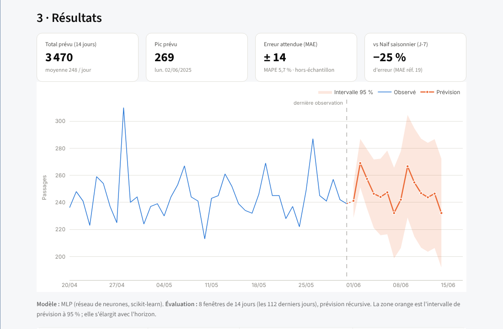

# 🏥 Prévision des passages aux urgences — Hôpital Mohamed V, Meknès

Application **Streamlit** de prévision du nombre de passages aux urgences, **par mois** (Prophet) et **par jour** (réseau de neurones MLP), avec intervalles d'incertitude et évaluation hors-échantillon.

🌐 **Application en ligne :** [prediction-passageauxurgences.streamlit.app](https://prediction-passageauxurgences.streamlit.app) · 📚 **Documentation :** `docs/` (Sphinx / Read the Docs)



---

## Sommaire

- [Contexte](#contexte)
- [Données](#données)
- [Résultats](#résultats)
- [Méthodologie](#méthodologie)
- [Installation](#installation)
- [Utilisation](#utilisation)
- [Structure du projet](#structure-du-projet)
- [Limites et perspectives](#limites-et-perspectives)
- [Auteurs](#auteurs)

---

## Contexte

Projet réalisé dans le cadre du module **Séries temporelles (2024–2025)**. Objectif : aider le service des urgences à **anticiper l'affluence** pour planifier le personnel et les ressources.


L'application comporte deux pages :

| Page | Contenu |
|---|---|
| **Introduction** | données, démarche, comparaison des modèles, tests de stationnarité, limites |
| **Prédiction** | choix mensuel / journalier, données du projet ou fichier Excel, horizon, prévisions + intervalle 95 %, erreur attendue, export Excel |

## Données

| Série | Statut | Période | Taille |
|---|---|---|---|
| `data/passages_mensuels.xlsx` | **réelle** — totaux mensuels | janv. 2024 → mai 2025 | 17 mois (moy. 7 409 / mois) |
| `data/passages_journaliers_simules.xlsx` | **simulée** | 01/01/2024 → 31/05/2025 | 517 jours (moy. 244 / jour) |

> ⚠️ **La série journalière est simulée.** L'hôpital n'a fourni que des totaux mensuels. Chaque total est réparti aléatoirement sur les jours du mois par un tirage multinomial ([`scripts/simuler_journalier.py`](scripts/simuler_journalier.py)) :
> - la somme des jours redonne **exactement** le total mensuel réel ;
> - la variabilité jour à jour est de type Poisson ;
> - un **profil hebdomadaire** (lundi +8 %, samedi −6 %…) est appliqué comme **hypothèse de simulation**. La saisonnalité de 7 jours que les modèles « découvrent » vient de cette hypothèse, pas d'une observation.
>
> Les performances journalières mesurent donc la capacité des modèles à retrouver la structure de la simulation et devront être revalidées sur de vraies données journalières.

## Résultats

Toutes les valeurs ci-dessous sont **calculées** par [`scripts/evaluer_modeles.py`](scripts/evaluer_modeles.py) et enregistrées dans [`results/metriques.json`](results/metriques.json) (lu par l'application).

### Prévision journalière — backtest sur les 112 derniers jours (8 × 14 jours, récursif)

| Modèle | MAE | RMSE | MAPE |
|---|---:|---:|---:|
| Ridge (features) | 14,1 | 17,3 | 5,6 % |
| **MLP** *(retenu)* | **14,2** | **17,7** | **5,8 %** |
| SARIMA(1,1,1)(1,0,1)₇ | 14,4 | 17,6 | 5,8 % |
| Moyenne mobile 7 j *(réf.)* | 15,0 | 20,0 | 6,0 % |
| Prophet | 15,2 | 18,6 | 6,0 % |
| Gradient Boosting | 15,6 | 19,3 | 6,2 % |
| Naïf saisonnier J-7 *(réf.)* | 18,9 | 23,8 | 7,6 % |
| Naïf veille *(réf.)* | 19,1 | 25,3 | 7,4 % |
| *Plancher théorique (oracle)* | *12,2* | | |

- Le MLP réduit l'erreur de **25 %** par rapport au modèle naïf « même jour la semaine précédente ».
- MLP, Ridge et SARIMA sont **à égalité** : les écarts (< 2 %) sont inférieurs au bruit.
- Le **plancher théorique** est l'erreur d'un oracle qui connaîtrait la valeur moyenne exacte de chaque jour sous la simulation : l'écart restant est un bruit aléatoire qu'aucun modèle ne peut prévoir. Les meilleurs modèles en sont proches (14,2 vs 12,2).

### Prévision mensuelle — prévision à 1 mois sur les 6 derniers mois

| Modèle | MAE | MAPE |
|---|---:|---:|
| Moyenne mobile 3 mois *(réf.)* | 197 | 2,6 % |
| **Prophet** *(retenu)* | 210 | 2,8 % |
| Naïf mois précédent *(réf.)* | 392 | 5,2 % |

Avec 17 mois, Prophet et la moyenne mobile sont équivalents ; 6 points de test ne permettent pas de les départager. Prophet est conservé pour ses intervalles d'incertitude et parce qu'il exploitera la saisonnalité annuelle dès que l'historique dépassera 24 mois.

### Tests de stationnarité (ADF : H₀ racine unitaire · KPSS : H₀ stationnaire)

| Série | Transformation | ADF p | KPSS p | Conclusion |
|---|---|---:|---:|---|
| mensuelle | niveau | 0,0002 | ≥ 0,10 | stationnaire |
| journalière | niveau | 0,0033 | ≤ 0,01 | non stationnaire (KPSS rejette) |
| journalière | différence ordre 1 | < 0,0001 | ≥ 0,10 | stationnaire → d = 1 |

## Méthodologie

- **Évaluation hors-échantillon (backtest à origine glissante)** : le modèle est entraîné sur le passé, prévoit la fenêtre suivante, puis l'origine avance. Aucune erreur n'est mesurée sur les données d'entraînement.
- **Baselines** : chaque modèle est comparé à des prévisions naïves ; un modèle qui ne les bat pas n'apporte rien.
- **MLP journalier** : features = lags (1, 2, 3, 7, 14 j), moyennes glissantes (7, 14 j), encodage cyclique jour/mois, indicateur week-end ; toutes calculées uniquement à partir du passé (pas de fuite de données). Architecture (64, 32), ReLU, Adam, régularisation L2, early stopping. Prévision **récursive** et évaluée comme telle.
- **Intervalle 95 % du MLP** : σ(h) = c·√h, avec c estimé sur les erreurs du backtest, plafonné par l'écart-type de la série → l'intervalle **s'élargit avec l'horizon**.
- **Prophet mensuel** : saisonnalité annuelle activée seulement si l'historique couvre ≥ 24 mois ; `changepoint_prior_scale = 0.05`.

## Installation

```bash
git clone https://github.com/issougmehdi75-alt/Prediction_PassageAuxUrgences.git
cd Prediction_PassageAuxUrgences
python -m venv .venv && source .venv/bin/activate   # Windows : .venv\Scripts\activate
pip install -r requirements.txt
streamlit run streamlit_app.py
```

Python 3.10+ (testé avec 3.13). Prophet installe automatiquement CmdStan.

Recalculer les données et les métriques :

```bash
python scripts/simuler_journalier.py     # régénère la série journalière (graine 42)
python scripts/evaluer_modeles.py        # recalcule results/metriques.json (~10 s)
pip install -r requirements-dev.txt && python -m pytest -q   # tests
```

## Utilisation

1. Page **Prédiction** → choisir **Mensuelle** ou **Journalière**.
2. Choisir **Données du projet** ou **Mon fichier Excel** (un exemple est téléchargeable).
3. Régler l'horizon (1–12 mois ou 1–60 jours) puis **Générer les prévisions**.
4. Lire la prévision, l'intervalle 95 %, l'**erreur attendue** (MAE/MAPE hors-échantillon) et le gain par rapport au modèle naïf ; exporter en Excel (feuilles Prévisions, Historique, Évaluation).

**Format du fichier** : colonne A = date, colonne B = nombre de passages. Dates acceptées : cellules date Excel, `2024-01-01`, `01/01/2024`, `Janvier 2024`, `janv. 2024`. L'en-tête est ignoré, les doublons sont additionnés, les jours/mois manquants sont signalés et interpolés. Minimum : 8 mois ou 60 jours.

## Structure du projet

```
├── streamlit_app.py            # interface (2 pages)
├── urgences/
│   ├── donnees.py              # lecture/validation Excel, dates françaises
│   ├── modeles.py              # baselines, SARIMA, Prophet, Ridge, GBM, MLP, backtest, intervalles
│   ├── prevision.py            # orchestration utilisée par l'application
│   ├── simulation.py           # désagrégation mensuel → journalier
│   ├── graphiques.py           # figures Plotly (palette unique)
│   └── style.py                # CSS
├── scripts/
│   ├── simuler_journalier.py
│   └── evaluer_modeles.py
├── data/                       # passages_mensuels.xlsx, passages_journaliers_simules.xlsx
├── results/metriques.json      # métriques calculées
├── tests/test_projet.py        # tests pytest
├── docs/                       # documentation Sphinx
└── .streamlit/config.toml      # thème
```

## Limites et perspectives

- Données journalières **simulées** (voir ci-dessus) ; historique mensuel **court** (17 mois).
- Aucune variable explicative : jours fériés, Ramadan, météo, épidémies saisonnières (grippe, bronchiolite) seraient des pistes naturelles.
- L'exploration initiale incluait XGBoost, LightGBM, LSTM et GRU ; ces résultats n'ont pas été conservés et ne sont pas présentés.
- Les prévisions sont **indicatives** et ne remplacent pas le jugement des équipes.

Voir [`docs/source/changelog.rst`](docs/source/changelog.rst) pour les corrections apportées en v2.0.

## Auteurs

**Issoug El Mehdi** · **Bado Ange Yipene Cenacle** — Projet Séries Temporelles 2024–2025, Hôpital Mohamed V, Meknès.

Licence : [Apache 2.0](LICENSE).
